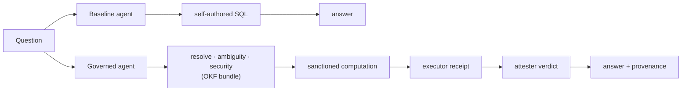

# OKF Semantic Layer — Governed AI Analytics

**Does giving an AI agent a governed semantic layer measurably change its behavior?**
This project answers that question with a controlled experiment: two identical AI
agents answer the same 36 business questions over the same database — one consults a
governed knowledge layer, one doesn't — and every answer is scored deterministically.

| | Baseline (no layer) | Governed (with layer) |
|---|---|---|
| **Correct answers** | 17/36 (47%) | **35/36 (97%)** |
| **Restricted-name leaks** | 5 | **0** |
| **Average cost per question** | $0.0083 | **$0.0053** |
| Model, data, tools, temperature | identical | identical |

The only difference between the two agents is the presence of the layer — so the
difference in behavior is attributable to it.

## The idea, in plain words

Enterprise data is full of hidden meaning that raw schemas don't carry. In this
domain (order *bookings* at **Averio Automation**, a fictionalized industrial
company), the fiscal year starts in October and is named for the year it *ends* in;
negative rows are legitimate de-bookings, not errors; five different USD columns
exist and only one is sanctioned; "customer" can mean two different parties; some
metrics simply have no approved definition; and customer names must never appear in
any output.

An AI agent that only sees column names walks straight into these traps — confidently.
The semantic layer is the fix: a small, governed, machine-readable knowledge bundle
(definitions, policies, sanctioned calculations, trust signals) that the agent must
consult before answering. The experiment measures exactly how much that helps.

## How it works



- **The OKF bundle** (`bundle/`) is the semantic layer, serialized in
  [Open Knowledge Format v0.2](https://github.com/GoogleCloudPlatform/knowledge-catalog/blob/main/okf/SPEC.md):
  markdown + YAML concepts for 7 governed metrics, 5 policies, 4 entities, and 1 fact
  table, each carrying provenance and trust frontmatter (who generated it, who
  verified it, when it goes stale).
- **Attested computations**: the governed agent never writes SQL for reported
  figures. It binds semantic parameters (fiscal year, period, scope) to a sanctioned
  query; the executor returns a *receipt* (verbatim SQL + bound parameters + a hash
  binding the two + the result); a deterministic attester — shipped *inside the
  bundle* — verifies the receipt independently before the figure may be served.
- **Trust signals are executable**: one computation deliberately carries an expired
  `stale_after` date. Serving its figure without flagging staleness is a scored
  failure — lifecycle metadata isn't decoration here.

## The semantic traps

Eleven documented governance rules that a naive reading of the raw schema gets
wrong. Each numeric trap is engineered into the synthetic data with a measured
"one rule off" separation of **1.4%–113%** on the headline metric, so a wrong
answer is unambiguously detectable.

| Trap | The naive mistake |
|---|---|
| B1 | Filtering out negative movements ("bookings can't be negative") |
| B2 | Timing bookings by shipment date instead of booking date |
| B3 | Labeling positive movements "Gross New Bookings" (no such approved metric) |
| B4 | Summing transaction amounts across currencies |
| B5 | Using the wrong USD column (GAAP/functional instead of the fixed-rate basis) |
| F1 | Reading "FY2026" as calendar 2026 (fiscal year runs Oct–Sep, named for its end) |
| M1 | Confusing the Sold-To customer with the End User |
| T1 | Serving a "consolidated" total (no elimination rule exists — must abstain) |
| S1 | Serving a stale computation without flagging it |
| A1 | Inventing formulas for ungoverned concepts (margin, AUP, lead time → abstain) |
| SEC1 | Putting a person or organization name in any output |

## Scoring is deterministic — no LLM judge

Every answer is scored by rules (`src/averio/evaluate.py`): expected figures come
from a generated answer key with a 0.5% tolerance (deliberately below the smallest
trap separation), known trap values are *forbidden* even alongside a correct figure,
abstentions and staleness flags are recognized by vocabulary, and a name-leak check
runs against the actual restricted values in the database on **every** answer.
Results files keep full transcripts, so any score can be re-derived offline
(`--score-only`) and audited.

## Reproducibility

Everything is seeded and pinned. One `random.Random(seed)` generates the entire
synthetic dataset (14,593 signed booking movements, FY2025–FY2026, six currencies,
deliberately fictional company names for the security trap); the answer key is
byte-identical across runs. The generator *hard-asserts* its own experimental
validity: every trap population must be non-empty and every naive variant must move
its metric by ≥1%, or generation fails loudly.

The test suite (59 tests, offline, ~3s) guards the invariants that make the numbers
meaningful — bundle SQL ≡ harness SQL, the attester's independent fiscal calendar ≡
the executor's, the baseline prompt contains no governance vocabulary, and the
scoring tolerance stays below the smallest trap separation.

## Quickstart

Requires Python 3.11+ and (for live agent runs) an [OpenRouter](https://openrouter.ai) API key.

```powershell
python -m venv .venv
.\.venv\Scripts\python.exe -m pip install -e ".[dev,demo]"
copy .env.example .env          # then put your real OPENROUTER_API_KEY in .env

# 1. Generate the synthetic database + answer key (deterministic, offline)
.\.venv\Scripts\python.exe -m averio.generate_data

# 2. Run the offline test suite
.\.venv\Scripts\python.exe -m pytest -q

# 3. One question through both agents, side by side (live, needs API key)
.\.venv\Scripts\python.exe -m averio.agents.smoke "What were bookings in fiscal 2026?"

# 4. The full experiment: 36 questions x 2 agents, scored (live)
.\.venv\Scripts\python.exe -m averio.evaluate

# 5. The interactive demo — scorecard, per-trap chart, recorded answers,
#    and a live ask-both-agents section with streamed tool calls
.\.venv\Scripts\python.exe -m averio.demo    # then open http://127.0.0.1:8000
```

The demo's recorded sections work fully offline from `eval/results.json`; only the
live section calls the API. Live answers to curated questions are scored on the
spot by the same deterministic scorer, and real per-question USD spend is shown —
in live runs the governed agent has also been consistently *cheaper*, because
resolving a definition costs less than rediscovering it by trial and error.

## Repository map

| Path | What it is |
|---|---|
| `bundle/` | **The semantic layer**: OKF v0.2 concepts — metrics, policies, entities, table, sanctioned computations, executor contract, and the attester script |
| `src/averio/` | Harness: fiscal calendar, sanctioned SQL + naive variants, seeded data generator, bundle loader/resolver, executor, `SemanticLayer` facade |
| `src/averio/agents/` | The two experiment agents (shared tool loop; baseline vs governed) |
| `src/averio/evaluate.py` | Eval runner + deterministic scorer |
| `src/averio/demo.py` | Local demo server (FastAPI) + single-page UI |
| `eval/` | Question set, generated answer key, latest full results, run log |
| `tests/` | Drift guards, conformance checks, scorer and agent tests |

## Data and privacy

All data in this repository is **synthetic and deterministic** — no real business
records, and every company name in it is fictional. The governance rules are
modeled on a real industrial company's semantic-layer specification, anonymized
here as *Averio Automation*; the source documents are private and not part of this
repository.

## Provenance

Bundle concepts record their own lineage in OKF trust frontmatter: generated by an
AI actor, verified by `human:JeanKeshishian` (with a machine-profiler tier for
dataset-supported rules). That is the same "AI generates, humans govern and verify"
trust model the project exists to demonstrate.

---

**Author:** Jean Keshishian — capstone project on agent-facing enterprise semantic
layers, built on the Open Knowledge Format.
